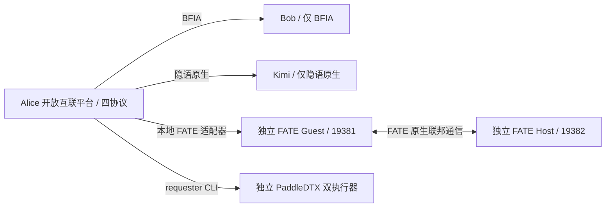

# 开放互联平台固定拓扑改造（2026-09-07）

本记录取代前一份验收中 FATE 复用 Bob 身份的拓扑结论；旧作业日志保留为历史证据。

## 目标拓扑

Alice 是统一控制入口；FATE Guest 是 Alice 对接的独立引擎实例，FATE Host 是原生联邦对端。两者都不是 Bob 或 Kimi。平台请求转换为 FATE 2.x 原生 DAG，通过 `/v2/job/submit` 执行，原生 Guest/Host 通过 OSX queue 模式联邦通信。协调式 LR 的 Arbiter 角色运行在原生 Host 内。

参与方名称不能与引擎内部服务数量混算：3 个命名平台节点（Alice/Bob/Kimi），另有独立 FATE 和 PaddleDTX 两套原生部署。

## 改造内容

- FATE 的 Kuscia 作业只有 Alice 一个适配器参与方。FATE Guest/Host 保留原生 party ID，不再映射为 Bob 调度身份。
- 拒绝将 Alice/Bob/Kimi 填入 FATE 原生参与方列表；拒绝让其他节点发起 Alice 的本地适配器任务。
- FATE 切换只验证 Alice 本地适配器和原生 FATE 双端；不再修改 Bob/Kimi 的域标签和路由。
- BFIA 与隐语切换只修复自身目标对，保留另一协议路由。
- Bob 能力清单仅 BFIA；接口层拒绝 FATE、PaddleDTX 和原生图/项目/作业接口。Kimi 延续独立上游原生 SecretPad。
- 移除 Bob 的遗留 `fate2-adapter` AppImage 注册，保留历史任务与数据。
- 页面提交表单提供本地原生 FATE party ID 示例与节点边界说明。
- `platform_runtime.py status` 增加路由协议和 FATE 双端检查。

## 本轮验证

- 后端：16 项选定测试通过，0 失败、0 跳过；包含原生身份隔离、节点 HTTP 边界、旧成功标记及客户端回归。见 `backend-build.log`。
- Go 适配器测试通过，覆盖原生 DAG 转换、拒绝 Bob 身份、原生任务失败不得报告成功等，见 `adapter-tests.log`。
- 前端：TypeScript、4 项 Jest 回归和 Umi 构建通过，构建结果已部署。见 `frontend-checks.json`、`frontend-build.log`。

| 协议 | 本轮实际作业 | 参与方与结果 |
|---|---|---|
| BFIA | `tqzj` | Alice/Bob，3 个算子节点 SUCCEED；见 `bfia-result.json` |
| 原生隐语 | `qwwh` | Alice/Kimi，Bob 停止时执行成功；见 `native-result.json` |
| 原生 FATE | 平台 `fj-077d3f4debcc4832` / 原生 `202609070522443247070` | Bob 停止时由页面提交 PSI→coordinated_lr（2 轮训练），原生 Guest/Host/Arbiter 全部 success，约 193 秒 |
| PaddleDTX | `17a612b6-8799-4ecd-9901-bb46556c4745` | 独立双 executor 预测 Finished，Bob 停止时完成；见 `paddledtx-result.json` |

FATE 的 `native-final-kuscia.json` 证明调度参与方仅 Alice；`native-final-adapter.log` 记录实际原生 job ID；`native-final-guest/host-job.json` 和 `native-final-guest/host-tasks.json` 证明双端作业、Reader、PSI、LR 和 Arbiter 全部成功。两端 PSI 表元数据和训练模型分别保存于 `native-final-*-psi-data.json`、`native-final-*-model.json`。平台最终状态见 `native-final-platform.json`。

## 原生 FATE 正确性与性能修复

旧适配器经 BFIA `/schedule/job/*` 执行，`FINISHED` 可能包含 READY/失败算子。旧记录 `fj-ef242e6d29d04b8e` 实际遇到 Docker provider 无法连接 Docker socket，不能作为成功证据。此次改用原生 API、原生 scheduler 和 OSX；仅原生作业与算子均 success 才允许适配器退出 0。旧适配器成功记录标为 `UNVERIFIED`，其历史日志保留以便追溯。

- 原生 FATE 的 computing parser 以前忽略 `engine_run.cores`，任务进程池按宿主 CPU 数量扩张；现在实际传递 `task_cores: 1`，并限制 BLAS/OpenMP 线程。
- OSX JVM 堆从 4 GiB 改为最高 512 MiB，直接内存上限 256 MiB；使用既有 Guest/Host 容器内的原生 OSX，无新增容器。
- 本地 p2p 配置默认连接 19381，双端原生身份探测用于切换和集群健康判断。
- 新镜像 `secretflow/fate2-adapter:0.2.0-native` 仅导入 Alice；构建脚本与 AppImage 同步。
- `configure_native_fate.py` 可重复应用，并在首次改动前备份已有配置。启动恢复钩子会启动原生 OSX。
- 早期性能诊断作业 `202609070504245489180` 的 PSI 成功，训练主动取消后进行并行度修复；它不是最终训练成功证据。

## 清理与保留

前一轮已删除 2 个废弃容器、3 个未引用旧试验镜像及可再生文件，清单保留在 `../acceptance-20260907/cleanup-*.json`。本轮另外移除 Bob 的 FATE AppImage 注册，删除已结束的临时 Node、Go 缓存及适配器构建目录，共 426,347,075 字节，见 `cleanup-temporary.json`。旧 Demo 集群注册清理前备份于 `clusters-before-cleanup.json`。数据库、账本、原生输出、源码与当前镜像保留。

运行规模口径：Alice/Bob/Kimi 是 3 个命名平台节点；FATE 与 PaddleDTX 是另外 2 套独立原生部署，共 5 个逻辑平台端。FATE 含 2 个原生引擎容器，PaddleDTX 含多个账本、存储和计算服务。全部项目容器共 28 个，包含代理与原生参考站点，不能当作 28 个参与节点。

本次是本地既有部署改造，不是 ECS/生产发布。无需重建账本、数据库或原生 FATE 引擎容器。

## 最终运行状态

最终 `runtime-status.json`：`healthy=true`，28/28 容器运行，Alice/Bob/Kimi 后端可访问；Alice–Bob 双向 BFIA 和 Alice–Kimi 双向 Kuscia 路由均 Ready，原生 FATE 双端就绪，PaddleDTX 在线且账本检查通过。Alice 当前选中 FATE，Bob 固定 BFIA。

页面实测：默认集群为“FATE 原生双端”，作业 `native-fate-psi-lr-bob-offline-20260907` 显示 SUCCESS，旧适配器成功记录显示 UNVERIFIED。Bob 最终直接调用 FATE/PaddleDTX 接口仍返回 HTTP 403，见 `bob-api-boundary-final.json`。旧 Demo 集群注册删除成功，见 `cluster-demo-cleanup.json`；底层历史数据未删除。

本轮验收覆盖四协议上述关键路径；不是所有算子、全部参数组合或生产环境验收。独立 FATE 本轮验证 Reader、PSI、coordinated LR；SecureBoost 的新 DAG 转换尚未进行本轮原生端到端执行。
